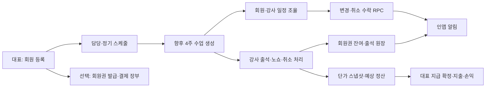
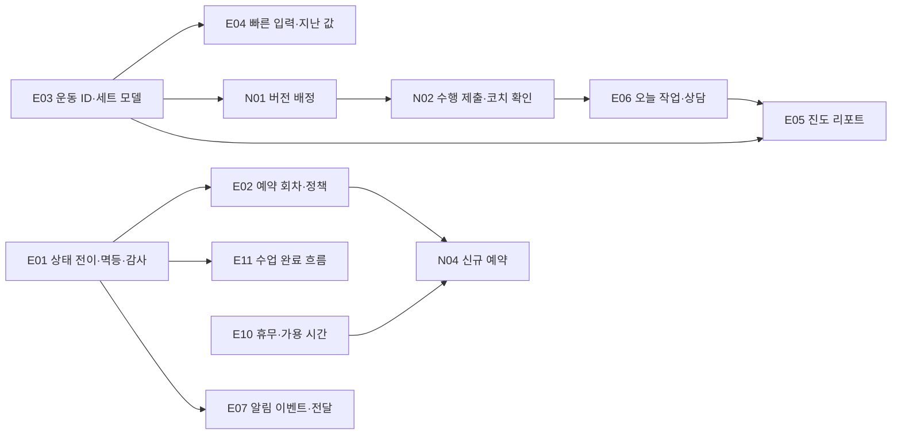

# Season PT v2 — PT 관리·운동 기록 앱 비교 및 개선 백로그

> 후속 구현(사용자 승인 범위): [수업 흐름 실행 계획·진행 기록](CLASS_WORKFLOW_IMPLEMENTATION_PLAN.md). 아래 보고서는 조사 당시 스냅샷이다.

> 조사일: 2026-10-23 · 코드 기준: `ba1c905` · 상태: 조사 보고서 완료(구현·운영 검증 전)
>
> 이 문서는 조사·개발 계획이다. 기능 코드·설정·DB·배포는 변경하지 않았다. 앱 실행, 운영 DB 조회, 실제 회원 파일·건강정보·비밀 환경변수 열람, 외부 서비스 연결, 설치, REA 실행을 하지 않았다.

## 1. 먼저 공유하는 현황

- **목업 단계가 아니다.** 회원·강사·대표 모바일 웹과 대표 PC 콘솔에 Supabase 조회·변이 코드가 있다. 문서의 과거 ‘미구현’ 표시는 현재 코드와 대조해야 한다.
- **운영 기본기는 이미 넓다.** 정기 일정/수업 생성, 출석·노쇼·정책 차감, 일정 변경·취소 요청/역제안/열람/결과, 회원권 발급·재등록·연장·정지·재개·환불·환불취소·양도, 결제 장부·미수금, 정산·지출·손익, 채팅, 공지, 식단 피드백, 체성분·진행 사진·인바디 PDF가 코드에 있다.
- **운동 기록도 회원 직접 입력까지 있다.** 강사 수업 기록과 회원 자유 운동 기록, 이전 수업 기록 불러오기가 존재한다. 다만 운동별 `kg/sets/reps` 요약 구조이며 세트별 값·루틴 배정·RPE·개인기록 분석 모델은 확인되지 않는다.
- **첫 개선 축은 ‘정확성·기록 밀도·지속 관리’.** 예약 중 회차의 별도 집계, 돈/출석의 다단계 변이 검증, 세트별 기록과 이전 기록 비교, 진도 리포트, 코칭 후속 업무를 기존 기능 위에 올리는 방향이 적합하다.
- **외부 알림과 결제는 별도 사업이다.** 현재 알림은 인앱 중심, 결제는 대표가 입력하는 장부다. 푸시/알림톡 실제 전달, PG 결제·자동 회원권 발급은 확인되지 않는다.

## 2. 증거와 판정 방법

- **직접 확인(observed):** 로컬 소스·SQL 마이그레이션·테스트 본문을 읽어 확인한 정적 구현 사실. 운영에서 정상 동작한다는 뜻은 아니다.
- **문서상 계획(documented):** 설계·감사·계획 문서의 주장. 현재 코드와 충돌하면 코드를 우선한다.
- **전달 근거(reported):** 부모 조사에서 받은 공식 앱/스토어/GitHub 자료. 직접 확인한 자료와 구분한다.
- **제안/추론(proposed):** 현재 구조와 외부 사례를 바탕으로 설계한 변경. 기존 결함·실제 사용자 불만으로 단정하지 않는다.
- **미확인(unverified):** 실행 화면, 운영 마이그레이션 적용 여부, DB 제약의 실제 적용 상태, 운영 Cron/Storage 설정, 서비스 성능, 앱별 유료 플랜/지역 제한.

조사 범위는 `AGENTS.md`, `README.md`, `package.json`, 관련 `docs` 문서, `src/app`·`src/lib`의 주요 파일, `supabase/migrations`와 단위 테스트다. 대형 vendor/generated 디렉터리를 재귀 탐색하지 않았고 전체 Git 파일 목록도 생성하지 않았다. `.env*`, 실제 회원 데이터, 저장된 건강 자료·이미지는 읽지 않았다.

## 3. 역할과 제품 구조

| 역할 | 현재 표면·권한 | 직접 확인한 근거 |
|---|---|---|
| 회원 | `/m` 일정·수업 상세, 변경/취소 요청·받은 제안·보낸 요청 이력, 채팅, `/m/my` 결제·운동·체성분·사진·식단·알림·공지. 서명 쿠키 검증 후 본인 범위로 접근 | `src/proxy.ts`, `src/lib/auth/context.ts:62`, `src/lib/data/groups/member.ts`, `src/lib/data/groups/member-actions.ts` |
| 강사(instructor) | `/t` 일정·출석·운동 기록, 담당 회원·식단/체성분/파일, 채팅, 일정 조율, 본인 실적·예상 정산 | `src/app/(app)/t/layout.tsx`, `src/lib/data/groups/scheduling-actions.ts:179`, `src/lib/data/groups/trainer-home.ts:984`, `src/lib/data/groups/member-files.ts:22` |
| 대표(owner) | 강사 표면 + 회원 등록/상품/결제/회원권·직원/정책 관리. `/console` 전체 운영·달력·회원·요청·메시지·매출·정산·손익·재등록 | `src/lib/auth/guard.ts`, `src/app/console/layout.tsx`, `src/lib/data/groups/owner-ops-actions.ts`, `src/lib/data/groups/finance-actions.ts` |
| 별도 관리자/매니저 | `trainer_role`은 owner/instructor 2종. `bootstrap_admin`은 대표 가입 여부 판정에서 제외하는 관리용 대표 표식이며 세분화된 관리자 권한 모델은 아니다 | `supabase/migrations/0001_v2_foundation.sql:9`, `supabase/migrations/0022_owner_bootstrap_admin.sql`, `src/lib/auth/context.ts:79` |

단일 스튜디오 구조다. 현재 주요 테이블에는 별도 `studio_id`/`tenant_id` 격리 모델이 보이지 않는다. 다지점 SaaS로 바로 확장할 수 있다고 가정하지 않는다.

## 4. 구현 범위 요약

| 영역 | 현재 코드에서 확인한 것 | 경계·미확인 | 증거 |
|---|---|---|---|
| 예약/일정 | 정기 스케줄→향후 4주 세션 생성, 1:1/2:1, 시간 변경 제안·역제안·수락·거절, 본인/담당 세션 가드, 요청 열람·보낸 이력, 고정 60분 기준 겹침 검사·이동 RPC 내 재검사 | 회원의 ‘빈 시간 신규 예약’·대기열·실별 자원 배정·가변 수업 길이 모델은 미확인 | `groups/maintenance.ts:27`, `groups/owner-ops-actions.ts:793`, `groups/member-actions.ts:188`, `groups/session-mutations.ts:14`, `groups/member.ts:493`, `groups/member.ts:565` (`groups`=`src/lib/data/groups`) |
| 출석/수업권 차감 | 출석 PNG 서명 필수, 수업 당일부터 처리, 출석/노쇼/취소 정책 차감, 회원별 원장·잔여 전후값, 처리 취소·복원 | 예약 시점 별도 hold/reservation 잔액 모델 미확인. 출석 확정은 상태 claim+여러 DB 호출+보상 복구; 전부 하나의 트랜잭션은 아님 | `groups/scheduling-actions.ts:179`, `src/lib/data/deduction.ts`, `supabase/migrations/0016_ledger_membership.sql` |
| 취소/변경 무결성 | 취소 차감은 회원 요청 생성 시점 기준; 변경 시 기존 슬롯 tombstone; 세션당 pending 요청 unique; 변경/취소 수락 RPC | SQL 파일 존재와 운영 적용은 별개. 기간·동시 처리·2:1 재시도 통합 검증은 실행하지 않음 | `groups/scheduling-actions.ts:593`, `groups/session-mutations.ts:50`, `supabase/migrations/0026_schedule_request_integrity.sql` |
| 회원권 | 상품·담당·정기 일정과 회원 등록; 발급/재등록/연장/정지/재개/환불/취소/양도·이력 | 등록은 상품/결제 선택 가능. 오래된 설계의 ‘결제 없으면 생성 안 함’과 다름. 회원권·결제 실패 시 warn을 돌려주는 부분 완료 구조 | `groups/owner-ops-actions.ts:27`, `:223`, `groups/membership-actions.ts:26`, `:49`, `:66`, `:83`, `:97`, `:162`, `:194` |
| 결제 | 현금/카드/계좌 장부, 여러 결제 행, 미수금, 환불 음수 매출, 회원 결제 이력 | PG 승인·결제 웹훅·셀프 결제/전자 영수증 근거 없음. 코드의 ‘카드’는 결제 수단 라벨 | `groups/owner-ops-actions.ts:336`, `:407`, `src/lib/data/balance.ts`, `groups/member.ts:1143` |
| 운동 기록 | 강사 수업 기록 추가/수정/삭제, 이전 수업 복사, 회원 자유 운동·과거일 기록/본인 기록 삭제, 회원 목록 조회 | 현재 운동당 요약 `name/kg/sets/reps`; 세트별 무게/반복/휴식/완료·안정적인 exercise ID·배정 프로그램·PR/RPE 모델 미확인. 2:1 저장 시 동일 배열이 참여 회원별로 기록됨 | `src/lib/types.ts:86`, `groups/scheduling-actions.ts:273`, `:328`, `groups/workout-actions.ts:39`, `groups/member.ts:1215`, `src/app/(app)/t/record/[id]/ui.tsx` |
| 진도/건강 기록 | 체성분 최근값·변화·이력·지표별 추세 차트, 회원 직접 입력과 강사 기록 구분, 진행 사진/인바디 PDF, 코칭 브리프가 수업·요청·식단·운동·체성분 신호 집계 | 건강 목표·세부 측정 조건/기기 출처·운동 수행량 장기 추세·정기 리뷰 계획 미확인. 단순 ‘진도/차트 기능 없음’으로 분류하면 안 됨 | `groups/body.ts`, `groups/body-actions.ts`, `src/app/(app)/m/my/body/BodySection.tsx:140`, `groups/trainer-home.ts:795`, `supabase/migrations/0012_member_files.sql`, `0025_body_self_record.sql` |
| 식단 | 회원 사진·메모·끼니·과거 기록, 수정/삭제, 강사 피드백 | 영양소 자동 추정·칼로리 DB·주간 목표 코칭 미확인 | `groups/meals-actions.ts:33`, `:91`, `:110`, `supabase/migrations/0013_meal_logs.sql` |
| 알림 | 잔여≤3/만료 임박, 요청·결과·2:1 파트너 결과 인앱 생성, 설정 2종 DB 저장, 인앱 읽음 | 수업 리마인더·출석/차감·이벤트/야간 푸시는 ready=false. 외부 전달·전송 재시도·수신 기기 구독 미확인 | `groups/notifications.ts`, `groups/member.ts:973`, `groups/member-actions.ts:345` |
| 채팅 | 1:1/2:1·읽음·낙관적 메시지 병합·가시 탭만 주기 폴링 | WebSocket Realtime·타이핑·외부 푸시 미확인 | `groups/chat-actions.ts`, `groups/chat.ts`, `src/lib/chat/merge.ts`, `src/lib/hooks/usePolling.ts` |
| 운영 관리 | 매출·미수·강사 단가/정산·지급 확정→인건비 지출, 손익, 회원 일괄등록, 재등록 대상·안내 완료, 공지·상품·정책·종목, 전역 검색·정산 투두 | 안내 완료는 guided 플래그이며 알림톡 발송 증거 아님. 상담 리드·체험전환 파이프라인·역할별 작업 큐·정교한 감사로그 미확인 | `groups/finance-actions.ts`, `groups/settlement.ts`, `groups/carryover-actions.ts`, `groups/perf-retention-actions.ts`, `groups/console-actions.ts:202`, `src/app/console/page.tsx:68` |
| PWA/오프라인 | manifest, 설치 안내, 서비스워커·오프라인 안내, 네트워크 상태 표시 | SW는 network-only. 운동 기록의 오프라인 저장/재동기화 지원으로 해석하면 안 됨 | `src/app/manifest.ts`, `public/sw.js`, `src/components/shell/ServiceWorkerRegister.tsx` |

### 목업·문서 부채 판정

`docs/design-handoff`는 프로토타입 참고물이고 `src/app/dev`는 컴포넌트 갤러리다. `src/lib/types.ts` 첫머리의 “mock now” 주석과 `src/lib/data/seed.ts`의 옛 주석은 현재 운영 데이터 접근(`db.ts`의 Supabase service-role) 전체를 목업으로 판단할 근거가 되지 않는다. 이번 조사에서는 seed 데이터 본문이나 실제 데이터는 읽지 않았다. 과거 감사 문서의 ‘공지/회원 운동 기록/정지/알림 설정/전역 검색/정산 투두 없음’은 해당 현재 코드가 있어 신규 제안에서 제외한다.

### 핵심 데이터 흐름

운동·건강 흐름은 별도다. 강사 수업 기록은 수업 참여 회원별 `workout_records`에 저장되고, 회원 자유 운동 기록은 `session_id/created_by=null`로 구분된다. 식단·체성분·사진은 회원 식별자로 연결되며 강사 코칭 브리프가 이를 조회한다. 채팅·진도 기록 자체가 회원권 차감이나 결제 승인으로 이어지지는 않는다.

### 정적으로 확인한 잔여 위험과 설계 전제

1. **출석·환불·정산 전체가 원자적인 것은 아니다.** 변경/취소 요청 수락에는 `0026` RPC가 있으나, `confirmAttendance`는 상태 claim→회원권 CAS→원장→실패 시 복구, `refundMembership`는 상태 claim→음수 결제→이력, `confirmSettlement`는 delete→insert다. 장애·동시성 통합 시험 전에는 ‘무결성 검증 완료’라고 쓰지 않는다.
2. **정정 원장을 영구 보존한다고 보기 어렵다.** `restoreProcessedSession`은 복원 후 기존 출석 원장 행을 삭제한다(`groups/scheduling-actions.ts:132`). 따라서 영구 감사 이력 제안은 기존 ‘원장 신설’이 아니라 정정/역분개 이력 보존 강화다.
3. **예약과 차감 회원권의 연결은 출석 시점에 결정된다.** `activeMembership`은 활성·잔여 양수·만료일 우선으로 고른다(`groups/scheduling-actions.ts:39`). 예약 시점 회원권 확보/귀속·유효기간 정책을 새로 설계할 필요가 있다. ‘실제 과예약 사고가 났다’는 운영 사실은 확인하지 않았다.
4. **2:1은 함께 출석·차감하는 운영 정책이다.** 현재 안내와 일치한다. 한 사람의 결석만 처리하는 정책으로 바꾸려면 상품·정산·동의 정책부터 별도 합의해야 한다. 운동 기록의 사람별 차등 입력은 이 출석 정책과 분리해서 개선할 수 있다.

## 5. 기술·검증 제약

- Next.js **16.2.9**, React **19.2.4**, TypeScript strict, Tailwind 4, Supabase SSR/Auth/DB/Storage, Bun. 서버 컴포넌트·Server Actions 중심. 근거: `package.json`, `tsconfig.json`, `README.md`.
- `AGENTS.md`는 코드 작성 전 `node_modules/next/dist/docs/`의 관련 지침을 읽도록 요구한다. 이번 작업은 조사 문서만 작성한다. 후속 Next.js 구현은 이 게이트를 지킨다.
- 회원은 커스텀 서명 HttpOnly 쿠키, 트레이너는 Supabase Auth. 비활성/탈퇴 회원과 비밀번호 설정 전 강사의 운영 권한을 서버 컨텍스트에서 차단한다. 실제 운영 인증 설정은 미확인. 근거: `src/lib/auth/context.ts`, `src/proxy.ts`.
- 데이터 접근은 service-role이 RLS를 우회하고 서버에서 본인/담당/owner 범위를 강제하는 구조다. 새 getter/action마다 권한 검사와 교차 계정 접근 검증이 필요하다. DB 자체가 모든 오류를 막아준다고 가정하지 않는다. 근거: `src/lib/data/db.ts`, `src/lib/auth/guard.ts`, `supabase/migrations/0001_v2_foundation.sql`.
- Vercel 설정은 서울 `icn1`, `/api/maintenance` 매일 20:00 UTC(05:00 KST) Cron이다. 코드 존재만 확인했으며 운영 실행 성공은 미확인. 근거: `vercel.json`, `src/app/api/maintenance/route.ts`.
- 단위 테스트는 차감·환불·미수금·정산·손익·KST·갱신·종목/상품·팀 슬롯·요청 검증·업로드·채팅 병합·Cron 인증을 다룬다. 예: `src/lib/data/deduction.test.ts`, `refund.test.ts`, `finance-calc.test.ts`, `scheduling-guards.test.ts`, `src/lib/auth/cron-auth.test.ts`. 이 테스트들은 DB 동시성·RPC·전체 역할 흐름의 통합 테스트를 대신하지 않는다.
- 이번에는 테스트·빌드·앱을 실행하지 않았다. 조사 문서 변경이며 런타임/서비스 접속 없이 확인 가능한 범위로 제한했다. 후속 구현 검증은 프로젝트 README의 타입/린트/Bun 테스트/빌드에 더해 변경 영역의 통합 시나리오를 포함한다.

## 6. 외부 레퍼런스 — 확인된 동작과 가져올 패턴

공식 기능 설명·도움말·스토어 개발자 설명·공개 저장소가 근거다. 제품 설치·로그인·유료 결제·실사용 QA는 하지 않았다. 스토어는 지역·시점에 따라 달라지며, 별점·다운로드 수·마케팅 효과 수치는 우선순위 근거로 쓰지 않았다. 아래 패턴을 Season PT에 적용하는 판단은 모두 제안이다.

| ID | 앱/자료·직접 링크 | 공개 자료에서 확인한 범위 | Season PT 적용 판단 |
|---|---|---|---|
| R1 | [바디코디 수업 예약](https://bodycodi.com/booking/), [PT 스튜디오](https://bodycodi.com/pt-studio/), [회원 앱 Google Play](https://play.google.com/store/apps/details?hl=ko&id=com.bodycodi.bpay) | 예약만큼 잔여 확보·초과 예약 차단, 대기자 자동예약·앱 알림. PT 문서는 판매 담당자·신규/재등록·노쇼 수당·코치별 커미션·강사 확인 흐름 설명 | 먼저 예약 중/사용 가능 회차 구분. 기존 정산에 없는 판매 기여·확인 이력만 후속 검토. 그룹 대기열·자동 결석은 일괄 적용하지 않음 |
| R2 | [Everfit Session Credits](https://help.everfit.io/en/articles/14698318-session-credits-manage-and-track-paid-client-sessions) | 발급/사용/반환/무효/만료 이력과 내부 메모, 예약 시 차감, 이른 취소 반환·늦은 취소 소진 유지. 문서는 현재 Owner만 예약 가능하다고 명시 | 기존 출석 원장·회원권 이벤트를 살려 예약 귀속·역분개·감사 추적 강화. Everfit과 같은 차감 시점·만료 규칙 채택은 별도 정책 결정 |
| R3 | [Hevy 이전 수행 도움말](https://help.hevyapp.com/hc/en-us/articles/34105442929943-Previous-Workout-Values-Vs-Routine-Values-How-to-Adjust-in-Settings), [운동 입력](https://www.hevyapp.com/features/track-workouts/), [App Store](https://apps.apple.com/us/app/hevy-workout-tracker-gym-log/id1458862350) | 세트 옆 이전 값, 전체 운동의 마지막 기록/같은 루틴의 마지막 기록 기준 선택. 이전 표시와 현재 입력 자동 변경은 별개. 세트 유형·RPE·휴식 타이머 설명 | ‘지난 기록 불러오기’에 더해 입력 옆 비교값. 목표·실제·이전값을 구분하고 복사는 명시적으로 수행 |
| R4 | [Strong App Store](https://apps.apple.com/us/app/strong-workout-tracker-gym-log/id464254577), [CSV 내보내기](https://help.strongapp.io/article/235-export-workout-data) | 운동 종류별 입력, 슈퍼세트·휴식 타이머·PR·CSV 내보내기. 도움말은 내보낸 CSV를 복원용으로 다시 가져올 수 없다고 명시 | 유형별 필드·입력 편의·분석 CSV 참고. CSV와 복원 가능한 백업을 다른 기능으로 정의 |
| R5 | [FitNotes — James Gay, Google Play](https://play.google.com/store/apps/details?id=com.github.jamesgay.fitnotes), [설정/백업 안내](https://www.fitnotesapp.com/settings/) | Android `com.github.jamesgay.fitnotes`. 세트 입력 중 이력 스와이프·세트 메모·타이머, 루틴 Log All, CSV 분석과 백업/복원 구분 | 간단한 입력과 템플릿 시작 흐름 참고. 동명 iOS 앱과 혼동하지 않음 |
| R6 | [Boostcamp RPE](https://www.boostcamp.app/features/rpe-logging), [프로그램 빌더](https://www.boostcamp.app/features/program-builder), [App Store](https://apps.apple.com/us/app/boostcamp-workout-tracker/id1529354455) | 세트 RPE 입력에 RIR 설명 힌트, 프로그램 목표 RPE/범위/%1RM, 주·일 복사, 배포 후 기존 사용자의 시작 버전 유지 | 초기에는 선택 RPE와 목표/실제 분리, 버전 고정 배정만. 독립 RIR 입력 필드가 있다고 일반화하지 않음 |
| R7 | [Hevy 월간 리포트](https://www.hevyapp.com/features/monthly-report/), [Hevy Coach 회원 진도](https://hevycoach.com/features/client-tracker/) | 운동·완료 세트·볼륨·PR 요약, 회원별 활동·운동/신체 변화 확인. 월간 리포트 도움말의 조회 기간 제약도 존재 | 기존 체성분 차트를 유지하고 운동 수행·출석·목표·코치 검토를 묶은 소규모 4주 리포트 제안. Hevy의 기간 제약까지 따라 할 이유는 없음 |
| R8 | [바디코디 온라인 결제](https://bodycodi.com/payment/), [전자계약](https://bodycodi.com/electronic-contract/) | 원격 결제 요청·결제 후 이용권 발급·매출 연결, 계약 관련 제품 표면 확인 | 현재 수동 장부와 별개 범위. PG/계약 의존성을 확보할 때 후속 검토 |
| R9 | [레슨북 공식](https://lessonbook.co.kr/), [Google Play](https://play.google.com/store/apps/details?hl=ko&id=com.pointbank.lessonbook) | 강사별 휴일/휴식·대체 강사·임시 수업, 수업 완료 시 회차 차감·피드백·수당 | 정기 일정만으로 표현하기 어려운 휴무·대체 수업 모델 참고. 수업 종료 흐름과 회원 기록 연결 강화 |
| R10 | [번핏 Google Play](https://play.google.com/store/apps/details?hl=ko&id=com.bunnit.haja.android) | 개발자 설명에 세트 복사·과거 기록·RPE·타이머·운동별 그래프 | 한국어 빠른 입력·세트 복사·진도 조회 참고. 과거 리뷰를 현재 재현 결함으로 사용하지 않음 |
| R11 | [ABC Trainerize Google Play](https://play.google.com/store/apps/details?hl=en&id=com.trainerize.Trainerize), [유료 예약 취소 도움말](https://help.trainerize.com/hc/en-us/articles/4404927564052-Canceling-paid-appointments) | 취소 마감 설정·회원 취소 시 회차 반환·코치의 반환/미반환 선택. 도움말은 정책 변경이 기존 예약에도 영향을 준다고 명시 | 차감 시점·취소 주체·정책 버전의 차이를 명시. Season에는 예약/요청 당시 정책 스냅샷을 제안하며, 이것이 Trainerize 현재 동작이라는 뜻은 아님 |
| R12 | [TrueCoach 회원 관리](https://help.truecoach.co/en/articles/2403919-managing-your-clients), [수행률 정의](https://help.truecoach.co/en/articles/2403738-compliance-rates) | 프로그램 종료·활동/수행률 기반 주의 회원. 수행률은 기간 내 배정 운동 대비 완료 운동 수로 계산하며 PT 출석률과 다름 | ‘오늘 관리 필요’ 큐·계획 종료·수행 감소 신호. 기록이 없는 회원을 실패로 일괄 판정하지 않고 분모/휴식일 정의 필요 |
| R13 | [Hevy Coach 회원 관리](https://hevycoach.com/features/client-management/) | 최근 활동·프로그램 배정·회원 대화, 코치 비공개 메모 | 현재 통합 회원 상세/브리프를 확장. 회원 공개 피드백과 코치 메모를 별도 권한·필드로 구분 |
| R14 | [Glofox 일정](https://www.glofox.com/features/scheduling/), [대기 승급 API 흐름](https://apidocs-plat.aws.glofox.com/flows/book/), [반복 결제 실패](https://support.glofox.com/hc/en-us/articles/46444686087316-What-Happens-When-a-Recurring-Payment-Fails) | 정원·대기·리마인더. 부모 조사에는 승급 때 예약 자격 재검증·결제 실패 재시도 근거 포함 | 그룹/정기 결제가 필요할 때 참고. 소규모 PT에 먼저 전체 도입하지 않음 |

R1 공식 웹·R2·R3의 이전 값 설정·R4 스토어·R5 스토어·R6 기능 문서·R7·R8 결제·R9·R10·R11 취소 도움말·R12 수행률·R13·R14 일정은 이 조사에서도 공개 페이지를 직접 열어 재확인했다. 나머지 보조 링크·스토어·도움말 세부 사항은 부모의 공식 자료 조사에서 전달받은 근거를 포함한다. 지원 플랜·기기별 세부 차이는 실사용 미검증이다.

### GitHub 레퍼런스 — 구조 참고와 코드 재사용은 별개

| ID | 저장소/설계 자료 | 확인 범위·주의 | 선택할 패턴 |
|---|---|---|---|
| G1 | [wger](https://github.com/wger-project/wger), [Routine API 구조](https://wger.readthedocs.io/en/latest/api/routines.html) | 직접 공개 페이지 확인. Django/Python 계열, AGPL-3.0-or-later. 계획 `Routine→Day→Slot→SlotEntry`와 실제 `WorkoutSession→WorkoutLog` 분리 | 계획/실적 분리와 구조화된 운동 ID. 전체 서버 교체는 제외. 코드·운동 데이터·이미지의 개별 라이선스는 각각 확인해야 함 |
| G2 | [Liftosaur](https://github.com/astashov/liftosaur), [변경 이력](https://github.com/astashov/liftosaur/blob/master/CHANGELOG.md) | 부모 공개 소스 조사: AGPL-3.0, 현재 package 기준 React 19/React Native 0.84/TS; README Preact 설명은 과거. 2026-09-22 입력 UI 확대·다음 세트·완료 버튼, 10-03 웹 에디터 개선 기록 | 운동 직후 큰 터치 영역·다음 입력·완료/취소 흐름. 복잡한 프로그램 DSL 전체 도입은 보류 |
| G3 | [workout.lol](https://github.com/workout-lol/workout-lol) | 부모 공개 소스 조사: MIT, Next 13.4.1/React 18/Mongo 계열. 조사한 기본 브랜치 최신 표시 커밋 2024-09-27 | 장비/부위 필터와 운동 선택 흐름만 참고. Next 16 앱에 예전 구조를 통째로 이식하지 않음 |
| G4 | [FitTrackee 원본(Codeberg)](https://codeberg.org/FitTrackee/FitTrackee), [GitHub 미러](https://github.com/SamR1/FitTrackee), [변경 이력](https://docs.fittrackee.org/en/changelog.html) | 부모 공개 소스 조사: Flask/Vue 3, AGPL-3.0-only, 1.3.6(2026-10-11). GPS 활동 중심으로 PT 세트 모델과 직접 적합성은 낮음 | 업로드 비동기 처리·오류 목록·공개 범위·개인 메모·데이터 export 패턴. export를 재수입 가능한 백업으로 단정하지 않음 |

G2~G4의 정확한 스택/시점/라이선스는 부모 전달 조사(reported)이며 이 작업에서 설치·빌드·의존성 실행으로 확인하지 않았다. AGPL 프로젝트를 참고했다고 코드 복사 승인을 받은 것은 아니다. 제안 백로그는 동작·데이터 모델의 패턴을 독립 구현하는 전제다. 소스·에셋을 재사용하려면 해당 파일의 라이선스와 제품 배포 조건을 별도로 검토한다.

## 7. 개발 가능한 백로그

**우선순위:** P0=돈·회차·권한 상태의 신뢰를 먼저 검증/보강, P1=다음 제품 개선 묶음, P2=기본 모델 이후 수요 확인해 확장. **효과/난이도:** 효과는 기대 방향(실측 아님), 난이도 S/M/L/XL은 상대 평가다. 달력 일정·비용 추정으로 사용하지 않는다. 신규 테이블 이름은 설계 예시이며 확정 스키마가 아니다.

### 7.1 기존 기능 개선

| ID·우선순위 | 누구의 문제·개선 내용 | 현재 코드 근거 | 참고 앱/직접 링크 | 예상 변경 영역·의존성 | 검증 기준 | 기대 효과 / 난이도 |
|---|---|---|---|---|---|---|
| E01 · P0 | 대표·강사: 출석 정정·환불·정산 도중 실패해도 회차/장부/이력이 함께 맞도록 강화. 정정은 삭제 대신 원기록+역분개로 보존 | `scheduling-actions.ts:132,179,776`, `membership-actions.ts:97`, `finance-actions.ts:80`; 변경/취소는 이미 `0026` RPC | [Everfit 원장·이력](https://help.everfit.io/en/articles/14698318-session-credits-manage-and-track-paid-client-sessions) | 관련 action→한 트랜잭션 RPC·멱등 키·audit 이벤트. 기존 `0026` 패턴 재사용; 운영 정책은 유지 | 동일 요청 재전송·두 기기 동시 처리·단계별 실패·2:1 부분 실패·정산 재확정 후 회원권 잔여/원장/매출/지출이 정합; 정정 작성자·사유·연결 원본 재구성 가능 | 데이터 신뢰 높음 / L |
| E02 · P1 | 회원·대표: ‘잔여’와 ‘이미 예약된 회차’ 혼동 해소, 잔여 초과 예약 위험을 사전에 표시. 예약/요청 당시 적용 정책을 보존 | `maintenance.ts:27`, `scheduling-actions.ts:39,679`, `owner-ops-actions.ts:722`; 현재 최신 정책 조회·별도 hold 없음 | [바디코디 예약](https://bodycodi.com/booking/), [Everfit credits](https://help.everfit.io/en/articles/14698318-session-credits-manage-and-track-paid-client-sessions), [Trainerize 취소](https://help.trainerize.com/hc/en-us/articles/4404927564052-Canceling-paid-appointments) | 1차 읽기 집계/경고, 2차 회원권 귀속·예약 확보·반환 이벤트·정책 버전 스냅샷. E01, 상품별 허용/무료 수업·만료/양도 정책 확정 | 잔여 2회+확정 예약 2회면 사용 가능 0 표시. 예약 이동 hold 중복 없음; 취소·정지·재등록·양도 결과 일치; 요청 후 정책 변경에도 당시 판정 재현 | 과예약 상담·분쟁 감소 / L |
| E03 · P1 | 회원·강사: 세트별 다른 중량/반복·시간 운동을 기록, 2:1 회원별 수행 차이를 보존 | `types.ts:86`, `scheduling-actions.ts:273`는 같은 배열을 각 회원에 저장; `workout-actions.ts:20` 수치 정수화 | [Hevy 입력](https://www.hevyapp.com/features/track-workouts/), [Strong 종류별 입력](https://apps.apple.com/us/app/strong-workout-tracker-gym-log/id464254577) | 운동 ID·이름 스냅샷, 세트별 actual/완료/종류·선택 RPE, 소수 kg·시간 필드. 기존 JSON 읽기 어댑터; PT 기록/자유 기록/콘솔 공용 컴포넌트 | 20kg×10/25kg×8을 다른 행으로 저장·조회; 2:1 A/B 값 다르게 유지; 과거 요약 기록 손실 없음; 미완료 세트는 수행량 제외 | 기록 품질 높음 / L |
| E04 · P1 | 운동 중 회원·강사: 과거 화면 왕복·반복 입력을 줄이고 직전 수행과 비교 | `t/record/[id]/ui.tsx:47`의 전체 불러오기, `scheduling-actions.ts:328`; 회원 입력 Stepper | [Hevy 이전 값 기준](https://help.hevyapp.com/hc/en-us/articles/34105442929943-Previous-Workout-Values-Vs-Routine-Values-How-to-Adjust-in-Settings), [FitNotes 이력](https://play.google.com/store/apps/details?id=com.github.jamesgay.fitnotes), [Liftosaur 이력](https://github.com/astashov/liftosaur/blob/master/CHANGELOG.md) | 이전 값 옆 표시·명시적 복사·숫자 입력·다음 칸·완료/실행취소·휴식 타이머. E03; 같은 루틴 비교는 N01 이후 | 이전값 표시만으로 오늘 실적 생성 안 됨. 종류별 키패드, 2.5kg 입력, 중복 탭 방지·실행취소, 360px/큰글자에서도 조작 가능 | 입력 시간·오류 감소 / M |
| E05 · P1 | 회원·강사: ‘몇 회 썼는지’에서 ‘무엇이 달라졌는지’로 상담 근거 확장 | `BodySection.tsx:140` 추세 차트·`trainer-home.ts:795` 브리프·`member.ts:1215` 운동 목록이 이미 존재 | [Hevy 월간 리포트](https://www.hevyapp.com/features/monthly-report/), [Hevy Coach 진도](https://hevycoach.com/features/client-tracker/) | 기존 차트+4주 출석/자유 운동/수행량/선택 목표·코치 리뷰. E03 안정 ID, 기록 완성도 기준; 측정값의 자가기록/강사기록 보존 | 같은 운동/단위/기간 기준 비교; 자료 없으면 ‘자료 부족’; 체중↓를 일괄 성공 판정하지 않음; 권한·체성분/운동 합계 검증 | 재등록 상담·동기 강화 / M~L |
| E06 · P1 | 강사·대표: 코칭 브리프를 ‘누가 언제 무엇을 해야 하는지’ 오늘 작업으로 연결하고 재등록 상담 다음 행동 관리 | `trainer-home.ts:795`의 미답변 식단·수업 없음·회차 임박 신호, `perf-retention-actions.ts:6` guided 플래그, `console/page.tsx:68` 운영 투두 존재 | [Hevy Coach 회원 활동](https://hevycoach.com/features/client-management/), [TrueCoach 수행률/주의 신호](https://help.truecoach.co/en/articles/2403738-compliance-rates) | 담당별 작업 큐, 체크인/식단 답변/자유 운동 확인/재등록 상담의 기한·완료·보류·다음 행동. N02와 연결; 규칙별 이유 표시 | 동일 신호 중복 없음; 담당 변경 시 승계; 완료가 발송으로 오표기되지 않음; 식단 답변 후 해소. PT 출석률과 개인운동 수행률 별도 분모 | 누락 방지·코치 효율 / M |
| E07 · P1 | 회원·강사: 앱을 열지 않아도 일정 결과·수업 리마인더를 전달하고 실패를 추적 | `notifications.ts` best-effort 인앱, `member.ts:973`의 reminder ready=false, network-only SW | [바디코디 앱 알림](https://bodycodi.com/booking/), [Everfit 인앱 만료 안내](https://help.everfit.io/en/articles/14698318-session-credits-manage-and-track-paid-client-sessions) | 이벤트/알림 outbox→전송 어댑터·중복방지·재시도·상태. 인앱부터 보강 후 Web Push/알림톡 중 채널 선택. 구독/수신 설정·운영 비용/제공자 의존 | 수업 이동 시 기존 리마인더 취소·새 시각 반영, 차감 결과와 실제 원장 일치; opt-out·미허용 기기·발송 실패/재시도·2:1 모두 확인 | 헛걸음·알림 누락 감소 / L(외부 채널은 XL 가능) |
| E08 · P2 | 대표·회원: 오래된 기록을 찾고 분석용 데이터를 꺼낼 수 있게 함 | `member.ts:1215` 50건, `member-files.ts:35` 60건, `body.ts:14` 최근 이력 조회. 이관 파서는 기존 | [FitNotes 백업·CSV](https://www.fitnotesapp.com/settings/), [Strong CSV 제한](https://help.strongapp.io/article/235-export-workout-data), [FitTrackee](https://docs.fittrackee.org/en/changelog.html) | 운동/파일/체성분 커서 페이지·날짜/종목 필터·분석 CSV. 복원 백업은 별도 스키마 버전·검증 모드·중복 키 요구 | 51번째 운동·61번째 파일 조회 가능, CSV 합계/단위/기간 일치, 다른 회원 자료 제외. CSV를 복원 가능으로 표시하지 않음 | 장기 데이터 신뢰 / M |
| E09 · P2 | 강사·회원: 저장 중 이탈·연결 불안정 때 입력 손실을 줄임 | 기록 폼은 로컬 state→수동 save, `public/sw.js`는 캐시/기록 동기화 없음 | [Hevy 오프라인 설명](https://apps.apple.com/us/app/hevy-workout-tracker-gym-log/id1458862350), [Boostcamp 기능](https://www.boostcamp.app/features) | 우선 서버 draft/저장 상태·충돌 버전·이탈 복구; 이후 제한적 로컬 초안. E03 안정 레코드 ID·멱등 키·공유 기기 계정 분리 | 저장 중/서버 저장됨/재시도 구분, 연속 탭 1건, 새로고침/재로그인·다른 계정 초안 격리, 실패 후 입력 보존 | 기록 손실 감소 / M~L |
| E10 · P2 | 대표·강사: 휴가·휴식·대체 강사·임시 수업을 정기 시간표와 별개로 관리 | `schedules`는 요일/시각, `hasSlotConflict`와 `0026`은 60분 고정. 선택 범위에서 휴무/대체/가변 길이 모델 미확인 | [레슨북 휴무·대체 수업](https://lessonbook.co.kr/) | availability/blackout·duration/buffer·대체 담당과 원담당·예외 수업. N04보다 선행; 자원/룸은 실제 수요 때 추가 | 휴무가 기존 확정 수업을 조용히 삭제하지 않음; 30/50/60분·버퍼 겹침, 대체 강사의 접근 범위/정산 귀속·회원 안내 검증 | 일정 운영 현실성 / L |
| E11 · P1 | 강사·회원: 수업 종료 때 기록·서명·출석·실차감·요약이 흩어지지 않도록 완료 체크리스트 제공 | `t/class/[id]/ui.tsx:103,245` 기록/출석 링크가 분리, `saveRecord`와 `confirmAttendance`는 별도 액션. 수업 상세 허브는 이미 있음 | [레슨북 완료·기록](https://lessonbook.co.kr/), [바디코디 PT 출결·수당](https://bodycodi.com/pt-studio/) | 기존 수업 상세에 기록 확인→회원 서명→출석 확정→잔여/다음 과제 요약. E01·E03, 선택 기록 허용/예외 사유 정책 | 네트워크 끊김·완료 중복에도 1회만 차감, 기록 저장 실패면 상태 명확. 출석 없는 운동 기록·무료 수업도 정상 예외. 요약 잔여는 원장과 동일 | 수업 마감 누락 감소 / M |
| E12 · P2 | 대표·강사: 본인 예상 정산 이후 내역 확인/이의 제기, 판매 기여와 재등록 인센티브를 투명하게 관리 | `settlement.ts`, `settlement-calc.ts`, `finance-actions.ts:80` 지급 확정은 이미 있음. 문서에서 인센티브 자동 규칙은 후속 확정 | [바디코디 코치별 급여·확인](https://bodycodi.com/pt-studio/) | 판매 담당/신규·재등록 구분·규칙 버전·정산 스냅샷·강사 확인/이의. E01; 회당 단가와 영업 커미션 분리 | 단가/담당 변경이 확정 과거 내역을 소급 변경하지 않음; 취소/환불 커미션 반영, 강사는 본인만 확인; 실제 이체 완료와 내부 확정 구분 | 정산 설명·협의 개선 / L |

이 표의 축약 파일명은 별도 표시가 없으면 `src/lib/data/groups/` 아래다. `BodySection.tsx`는 `src/app/(app)/m/my/body/`, `t/record/[id]/ui.tsx`는 `src/app/(app)/` 아래다.

### 7.2 신규 기능

| ID·우선순위 | 누구의 문제·기능 범위 | 현재 코드 근거 | 참고 앱/직접 링크 | 예상 변경 영역·의존성 | 검증 기준 | 기대 효과 / 난이도 |
|---|---|---|---|---|---|---|
| N01 · P1 | 강사·회원: PT 없는 날 할 운동을 지정하고 목표 대비 실제 수행 확인. 처음은 1주 템플릿·배정부터 | 기존 `exercises`는 종목 목록, `workout_records`는 실적; 배정/프로그램 테이블은 선택 범위에서 미확인 | [wger 계획/실적 API](https://wger.readthedocs.io/en/latest/api/routines.html), [Boostcamp 빌더](https://www.boostcamp.app/features/program-builder) | templates/versions/assignments 및 세트 목표 스냅샷; E03. 회원 시작 버전 고정, 다음 배정에만 개정 적용 | 목표만 배정해도 실적·차감 생성 안 됨. 템플릿 수정이 시작한 회원 계획/과거 기록을 변경하지 않음. 비담당 배정 거부 | 수업 밖 코칭 연결 / L |
| N02 · P1 | 회원·강사: 자유 운동 완료·주간 상태를 코치가 확인하고 다음 수업에 반영 | `logMyWorkout`와 브리프 최신 운동은 있으나 제출→확인→답변 상태는 미확인 | [Hevy Coach 활동/기록](https://hevycoach.com/features/client-tracker/) | 선택 주간 체크인·회원 수행 제출·코치 review 상태/댓글·주간 응답. E06; 상태 기록은 건강 진단으로 해석하지 않음 | 자유 운동 제출→담당 큐→코치 답변→회원 확인으로 연결; 미작성/없음 구분; 동시 답변·삭제 정책 일관 | 지속 관리·후속 상담 / M |
| N03 · P2 | 대표·강사: 체험/상담→등록까지 놓치는 문의를 추적 | 회원 생성·재등록 guided는 있으나 독립 상담 리드 단계/후속 예정일 모델 미확인 | [바디코디 결제 요청 흐름](https://bodycodi.com/payment/)을 등록 전 단계로 확장한 자체 제안 | leads·trial·follow-up·전환 연결; 회원 중복 방지. 강사 등록 요청/대표 승인도 이 큐 안에서 검토 | 상담에서 회원 전환 시 중복 회원/결제 없음; 담당·기한·전환 이유 추적; 미승인 강사가 정식 회원권 발급 못 함 | 신규 문의 전환 관리 / M~L |
| N04 · P2 | 회원: 담당 강사의 실제 가능한 빈 시간에 신규 수업 요청 | 현재 `/m/request`는 기존 세션의 변경/취소 중심; `getProposeSlots`는 대안 슬롯 | [바디코디 예약](https://bodycodi.com/booking/), [Everfit credits](https://help.everfit.io/en/articles/14698318-session-credits-manage-and-track-paid-client-sessions) | 강사 가용 시간·휴무/버퍼·유효 회차·신청/확정. E01/E02, 신규 예약 허용 운영 정책. 2:1은 파트너 동의·정책 별도 | 같은 슬롯 동시 요청 시 정책상 한 예약만 확정; 비근무/휴무·무회차·회원권 유효기간 검증; 기존 조율 흐름 유지 | 일정 왕복 감소 / L |
| N05 · P2 | 강사·회원: 운동 찾기와 올바른 설명을 빠르게 확인 | 종목은 이름/카테고리/활성 위주(`types.ts:611`, `owner-ops-actions.ts:755`) | [workout.lol 장비·부위 필터](https://github.com/workout-lol/workout-lol), [wger 운동 목록](https://github.com/wger-project/wger) | 종목 ID·별칭·장비·주요 부위·운동 유형·자체 설명/영상 링크. E03에서 ID는 먼저 도입 | 기존 이름 수정해도 과거 실적 표시 보존; 장비/부위 필터 조합 정확; 허가 없는 외부 이미지 미수집 | 종목 선택·설명 효율 / M |
| N06 · P2 | 강사·대표: 회원에게 보일 피드백과 내부 상담·인계 메모를 구분 | 회원 상세/부상 메모·운동 comment는 있으나 독립 내부 메모 ACL 모델은 선택 범위에서 미확인; 운동 comment는 회원 기록에 표시 | [Hevy Coach 비공개 메모](https://hevycoach.com/features/client-management/) | coach_notes·작성자/수정 이력·공개 범위. 회원 공개 댓글과 API/타입 분리; E06 인계 작업 연결 | 회원 응답 payload·페이지·export에 내부 메모가 섞이지 않음; 비담당 강사 열람/수정 차단; 인계 시 허용 범위만 이전 | 상담·인계 정확성 / M |

N03은 비교 앱에서 같은 상담 파이프라인을 확인했다는 주장이 아니라, 현재 ‘회원 생성 이전’ 공백과 결제 요청 사례를 연결한 제품 제안이다. 전체 CRM을 먼저 만들 필요는 없다.

### 7.3 보류 — 도입 조건이 생기면 다시 판단

| ID | 누구의 문제·후보 | 현재 근거·참고 링크 | 보류 이유·예상 변경 영역/의존성 | 재개 조건·검증 기준 | 효과 / 난이도 |
|---|---|---|---|---|---|
| H01 | 회원 셀프 결제·자동 회원권 발급·영수증 | 현재 `payments`는 수동 장부. [바디코디 온라인 결제](https://bodycodi.com/payment/) | PG 계약·별도 인증·웹훅·부분환불·대사·결제 재시도까지 필요. E01/E02와 회원권 상태 정합 선행 | 실제 원격 결제 수요·정산 조건 확보 후 sandbox에서 중복/역순 웹훅·취소/환불·금액 대사 통과 | 잠재 높음 / XL |
| H02 | 그룹 대기열·자동 빈자리 승급·미처리 자동 노쇼 | 현재 1:1/2:1과 회원 서명 출석. [바디코디 예약](https://bodycodi.com/booking/) | 그룹 정원·출결 단위·자동 차감은 현 PT 정책과 다름. 세션/참여자 상태·정산 변경 | 그룹 운영 필요가 확인되고, 미처리≠실제 노쇼 예외/소명 흐름을 합의한 뒤 동시 취소/승급·회차 원복 검증 | 수업 규모에 따라 다름 / L~XL |
| H03 | 다지점·매니저/세분 권한 | 현재 owner/instructor·단일 스튜디오. [wger 멀티유저](https://github.com/wger-project/wger) | `studio_id` 격리·역할 권한·전 getter/action/Storage/RPC 영향. 표식 admin을 매니저로 재사용 금지 | 실제 위임/복수 지점 수요 확정 후 역할/테넌트 교차 접근 테스트를 전 기능에 적용 | 현재 낮음 / XL |
| H04 | 완전 오프라인·워치/HealthKit·Health Connect | 현재 network-only PWA. [Hevy 스토어](https://apps.apple.com/us/app/hevy-workout-tracker-gym-log/id1458862350), [Boostcamp 기능](https://www.boostcamp.app/features) | 기록 충돌·기기/권한·삭제 전파·배터리·네이티브 배포 의존. 우선 E09 저장 복구 | 실제 오프라인 빈도·기기 수요가 확인된 뒤 오프라인 중 동시 수정/로그아웃·재연결 중복·삭제 충돌 검증 | 대상에 따라 다름 / XL |
| H05 | 소셜 피드·랭킹·공개 공유 | 현재 담당 코칭/개인 기록 중심. [Hevy 기능](https://apps.apple.com/us/app/hevy-workout-tracker-gym-log/id1458862350) | 사업목적·공개 범위·중재·수신 설정과 비용이 우선순위보다 큼 | 회원 수요·비공개 기본값·공유 취소/차단 정책 합의; 노출 범위·접근 철회 검증 | 현재 낮음 / L |
| H06 | AI 자동 처방·자세 진단·식단 자동 판정·복잡 프로그램 DSL | 현재 부상 메모·단순 운동 실적. [Liftosaur](https://github.com/astashov/liftosaur), [Boostcamp 빌더](https://www.boostcamp.app/features/program-builder) | 구조화 데이터·목표·코치 검토가 먼저. 자동 판단을 현재 기록만으로 신뢰할 근거 부족 | E03/N01/N02 데이터 품질·검토 책임·오류 평가가 마련된 뒤 코치가 검토하는 초안부터 검증 | 불확실 / XL |

## 8. 최우선 5개와 실제 착수 단위

| 순서 | 묶음 | 첫 결과물·범위 | 먼저 결정할 사항 |
|---|---|---|---|
| 1 | **수업 완료·차감·정정 신뢰성** — E01/E11 | 현 흐름 상태 전이표·다단계 실패 통합 시험, 출석/정정 RPC와 역분개 이력, 수업 종료 체크리스트. 운동 입력 UI 전체 개편 없이도 데이터 경로부터 착수 가능 | 무료 수업·무회원권·2:1 전체 처리 원칙, 정정 사유·권한, 내부 정산 확정과 실제 지급 의미 |
| 2 | **예약 중 회차·당시 정책 보존** — E02 | 먼저 ‘잔여/예약 예정/추가 가능’ 읽기 집계와 경고. 후속으로 명시적 확정 예약만 회원권에 귀속·확보하고 취소/만료에 반환 | 정기 스케줄이 만든 미래 세션을 모두 확정 예약으로 볼지, 추가 회차 부족 때 경고/차단, 만료일 기준과 정책 변경 적용 시점 |
| 3 | **세트별 실적·지난 수행 옆 비교** — E03/E04 | 기존 기록 읽기 유지→운동 ID/세트 행→숫자 입력/복사/완료/취소→이전 값. 먼저 PT·자유 운동 공용 입력기 하나 | 필수 운동 유형(중량/횟수/시간), 소수 중량·단위, 2:1 개인별 기록·선택 RPE |
| 4 | **개인운동 배정→코치 확인** — N01/N02/E06 | 1주 템플릿·버전 배정, 회원 실제 수행, 강사 오늘 검토 큐. 장기 주기화/복잡 DSL 없이 시작 | 과제 완료 분모·휴식/제외일, 코치 확인/회원 공개 피드백, 미작성 상태와 비공개 메모 경계 |
| 5 | **4주 진도·재등록 리뷰** — E05/E06 | 기존 체성분 차트·브리프에 출석/개인운동·주요 운동 변화·목표·상담 다음 행동을 연결. 새 대시보드 여러 장 대신 회원 상세 한 흐름 | 회원과 합의한 목표, 비교 가능한 운동/측정 조건, 상담 상태/다음 일정·담당 |

예약 확보는 외부 앱의 ‘예약 즉시 소진’을 그대로 복제하는 제안이 아니다. 현재 `remaining_sessions`를 미사용 잔여로 유지한다면 `사용 가능 = 미사용 잔여 − 확정 예약 확보분`으로 설명할 수 있다. 회차 소진·확보·반환의 이벤트 정의를 먼저 만들고, 같은 회차를 출석 때 다시 이중 차감하지 않아야 한다. `generateUpcomingSessions(4)`가 만든 모든 미래 슬롯을 바로 회차 확보로 바꾸면 장기 정기 일정과 충돌할 수 있으므로 **예정 슬롯과 확정 예약의 구별**부터 정한다.

운동 모델도 이행이 필요하다. 기존 `{name, kg, sets, reps}`를 삭제/강제 변환하지 말고, 표시 어댑터를 둬 옛 기록과 새 `setRows`를 함께 읽는다. 과거 요약에서 개별 세트의 실제 차이를 복원할 수는 없으므로 임의의 상세 실적을 만들어내지 않는다. 계획 목표와 실제 수행은 서로 다른 필드/레코드에 두고 복사·완료 동작으로만 실제를 만든다.

### 의존 순서와 작게 나누는 기준

- **기반 묶음:** E01 상태표/통합 시험과 E03 호환 스키마 설계. 기능 수를 늘리기 전에 DB 변경·되돌림 전략을 검토한다.
- **체감 묶음:** E04 입력 편의·E11 종료 흐름·E02 읽기 집계를 작은 단위로 적용한다. UI는 작은 모바일 화면과 대표 콘솔에서 모두 확인한다.
- **코칭 묶음:** N01 1주 배정→N02 확인→E06 작업→E05 리뷰 순으로 한 회원의 전 흐름을 완성한다.
- **연동 묶음:** E07은 인앱 이벤트 신뢰성을 먼저 확보하고 실제 외부 채널을 선택한다. N04/H01은 회차·일정·회원권 상태 기반 위에서 별도 범위로 진행한다.

이 순서는 제품/기술 제안이며 승인된 구현 일정이 아니다. 한 번에 전체 백로그를 개발하기보다 각 묶음의 수용 기준을 통과한 뒤 다음 범위를 선택한다.

## 9. 후속 구현의 수용 테스트와 관찰 지표

현재 운영 자료를 읽어 지표를 계산하지 않았다. 아래 테스트는 후속 구현 시 합성 데이터·격리 테스트 DB에서 수행할 기준이다. 운영 데이터를 이 보고서 검증에 쓰지 않는다.

| ID | 수용 시나리오 | 기대 결과·대상 백로그 |
|---|---|---|
| A01 | 잔여 마지막 1회를 두 기기가 서로 다른 수업으로 동시에 확보/확정 | 정의한 예약 정책상 하나만 사용 가능, 음수/중복 확보 없음. E01/E02/N04 |
| A02 | 출석 완료를 두 번 전송, 응답 직전 네트워크 단절 후 재시도 | 한 번 차감·서명·원장·정산 기여. 두 번째 응답은 이미 처리된 결과를 안전하게 반환. E01/E11 |
| A03 | 2:1 두 번째 회원 차감/원장 저장에 실패 | 전체 출석 처리 실패 또는 명시한 트랜잭션 경계로 원복. 첫 회원만 조용히 소진되는 상태 금지. E01 |
| A04 | 취소 마감 전/후 요청, 강사가 뒤늦게 수락; 요청 후 정책 변경 | 요청 시점·정책 버전·취소 주체가 보존돼 회차 반환/소진을 재현. 회원/대표 잔여 일치. E02 |
| A05 | 회차 확보 후 회원권 만료/정지/재등록/양도/환불, 무료 수업 | 명시한 정책대로 귀속·확보·반환 처리, 이중 차감 없음. 무료와 유료 소진을 구분. E01/E02 |
| A06 | 출석→정정→재출석과 같은 요청 재시도 | 잔여·정산은 최종 상태와 일치하며 원본/정정자/사유/역분개를 계속 조회 가능. E01 |
| A07 | 환불·환불 취소·정산 확정의 중간 DB 실패·동시 재시도 | 회원권/결제/이력 또는 정산/인건비가 한 번만 반영. 실패 상태 식별·안전한 재시도. E01/E12 |
| A08 | 강사 A가 강사 B의 회원 ID·세션 ID·파일 ID·새 메모 ID를 조작; 탈퇴 회원 재접속 | 모든 getter/action/파일 URL/새 RPC에 동일 범위 적용, 회원 비공개 메모 payload 미포함. N01/N06 포함 전 기능 |
| A09 | 과거 요약 기록과 새 세트 기록, 종목 이름 변경·소수 kg·시간 운동 | 과거 기록 손실 없음, 이름 스냅샷·단위 유지. 미완료/목표 세트는 실제 집계에서 제외. E03/E05 |
| A10 | 2:1 A=20kg×10, B=10kg×8로 저장·조회/수정 | 개별 실적이 섞이지 않으며 기존 함께 출석 정책은 명확히 표시. E03 |
| A11 | 이전값 옆 표시→명시적 복사→완료→실행취소; 같은 루틴/전체 비교 전환 | 이전 표시가 오늘 값/목표를 자동 덮어쓰지 않음. 기준일·출처를 표시. E04/N01 |
| A12 | 템플릿 v1로 회원 시작 후 코치가 v2로 개정 | 기존 배정·실제 수행·과거 리포트는 v1, 새 배정만 v2. 목표와 실제가 분리. N01 |
| A13 | 자유 운동 제출·코치 답변·담당 변경·재등록 상담 보류 | 완료/미확인/자료 없음이 구분되고 큐 중복 없음. PT 출석률과 과제 수행률을 별도 계산. E06/N02 |
| A14 | 입력 중 새로고침·저장 실패·연결 복귀·공유 기기 계정 전환 | 임시 입력 복구·동기화 상태 표시·중복 저장 없음. 다른 계정이 초안 열람 불가. E09 |
| A15 | 수업 이동/취소 후 기존 리마인더와 실패 알림 재전송 | 오래된 일정 알림 취소·단일 전달·수신 설정 준수·실패가 ‘보냄’으로 표시되지 않음. E07 |
| A16 | 기존 조회 상한을 넘는 장기 기록과 내보내기 | 커서 누락/중복 없음, CSV와 화면 합계 동일, 개인정보·내부 메모 권한 준수. E08 |

기존 Bun 단위 테스트에 더해 RPC 트랜잭션·실패 주입·역할별 API 호출·핵심 모바일/콘솔 사용자 흐름을 검증해야 한다. 실제 회원/강사 세션을 이용하는 운영 QA는 별도 범위로 정한다. README의 `bunx tsc --noEmit`, `bun run lint`, `bun test`, `bun run build`는 후속 구현의 기본 게이트이며 이번 조사에서 실행한 명령이 아니다.

| 기대 효과 | 먼저 관찰할 지표 | 해석 주의 |
|---|---|---|
| 수업 마감 정확성 | 종료 후 기록/출석 미처리 수, 회차·원장 불일치, 반복/실패 요청의 최종 결과 | 과거 데이터가 없으면 도입 전 기준부터 정의. 오류가 이미 발생했다고 단정하지 않음 |
| 입력 효율 | 대표적인 3종목 기록의 조작 수·입력 시간·취소/재입력 수 | 실제 과제를 정해 전/후 비교; 특정 앱이 더 빠르다는 마케팅 수치 사용 금지 |
| 지속 코칭 | 배정 대비 실제 수행, 코치 미확인 수/확인 소요, 식단 미응답 | 단순 앱 방문·PT 출석·자유 운동 수행을 같은 지표로 합치지 않음 |
| 재등록 상담 | 대상→상담 예정→상담 완료→재등록의 단계와 다음 행동 누락 | 재등록 증가를 기능의 인과 효과로 단정하지 않음 |
| 전달 신뢰성 | 알림 생성/대기/성공/실패·중복률, opt-out 위반 | ‘행 생성’과 ‘회원에게 도착’은 별개 |

## 10. 증거 위치·문서 간 충돌·남은 확인

### 주요 코드 근거 바로가기

| 근거 | 파일·확인 지점 |
|---|---|
| 프로젝트 지침·현재 기능 개요 | [AGENTS.md](../AGENTS.md), [README.md](../README.md), [package.json](../package.json) |
| 초기 아키텍처·현재 상태와 대조할 옛 계획 | [초기 설계](superpowers/specs/2026-06-22-season-pt-v2-design.md), [회원권 수명주기 설계](superpowers/specs/2026-06-27-membership-lifecycle-design.md), [재무 설계](superpowers/specs/2026-07-02-store-finance-management-design.md), [사용성 실행계획](USABILITY_IMPLEMENTATION_PLAN.md) |
| 서버 서비스 권한/인증 문맥 | [db.ts](../src/lib/data/db.ts), [auth/context.ts](../src/lib/auth/context.ts) 23/52/62/86, [auth/guard.ts](../src/lib/auth/guard.ts), [proxy.ts](../src/proxy.ts), [console/layout.tsx](../src/app/console/layout.tsx) |
| 기본 스키마 | [0001 foundation](../supabase/migrations/0001_v2_foundation.sql), [0003 운영 설정](../supabase/migrations/0003_ops.sql), [0005 회원권 이벤트/알림](../supabase/migrations/0005_membership_lifecycle.sql) |
| 요청/이동/취소 원자 처리 | [0026 request integrity](../supabase/migrations/0026_schedule_request_integrity.sql) 32/157, [session-mutations.ts](../src/lib/data/groups/session-mutations.ts) 14/50/76, [member-actions.ts](../src/lib/data/groups/member-actions.ts) 188 |
| 출석/정정/기록/차감 | [scheduling-actions.ts](../src/lib/data/groups/scheduling-actions.ts) 39/132/179/273/328/593/776, [deduction.ts](../src/lib/data/deduction.ts), [차감 테스트](../src/lib/data/deduction.test.ts) |
| 회원 등록/상품/결제/일정 | [owner-ops-actions.ts](../src/lib/data/groups/owner-ops-actions.ts) 27/223/336/407/722/793/893, [balance.ts](../src/lib/data/balance.ts), [등록 화면](../src/app/%28app%29/t/members/register/ui.tsx) |
| 회원권 수명주기 | [membership-actions.ts](../src/lib/data/groups/membership-actions.ts) 26/49/66/83/97/162/194, [renewal.test.ts](../src/lib/data/renewal.test.ts), [refund.test.ts](../src/lib/data/refund.test.ts) |
| 회차 원장·서명·동시성 제약 | [0016 원장 회원권 연결](../supabase/migrations/0016_ledger_membership.sql), [0017 동시성](../supabase/migrations/0017_concurrency_backstops.sql), [0019 수업 서명](../supabase/migrations/0019_session_signature.sql) |
| 세트 전 현재 타입/자유 운동 | [types.ts](../src/lib/types.ts) 86, [workout-actions.ts](../src/lib/data/groups/workout-actions.ts) 20/39/70, [회원 운동 조회](../src/lib/data/groups/member.ts) 1215 |
| 회원 상세·코칭 브리프·체성분 차트 | [trainer-home.ts](../src/lib/data/groups/trainer-home.ts) 646/795, [회원 상세](../src/app/%28app%29/t/members/%5Bid%5D/page.tsx), [BodySection](../src/app/%28app%29/m/my/body/BodySection.tsx) 140 |
| 식단·체성분·파일 권한 | [meals-actions.ts](../src/lib/data/groups/meals-actions.ts), [body-actions.ts](../src/lib/data/groups/body-actions.ts), [member-files.ts](../src/lib/data/groups/member-files.ts) 22/35, [upload-guard.test.ts](../src/lib/media/upload-guard.test.ts) |
| 알림 생성/준비 상태 | [notifications.ts](../src/lib/data/groups/notifications.ts) 38/52/74/89/134, [member.ts](../src/lib/data/groups/member.ts) 973/1026, [member-actions.ts](../src/lib/data/groups/member-actions.ts) 345 |
| 채팅 폴링·중복 병합 | [usePolling.ts](../src/lib/hooks/usePolling.ts), [merge.ts](../src/lib/chat/merge.ts), [채팅 병합 테스트](../src/lib/chat/merge.test.ts) |
| 정산·지출·손익 | [settlement.ts](../src/lib/data/groups/settlement.ts), [finance-actions.ts](../src/lib/data/groups/finance-actions.ts) 80, [손익 테스트](../src/lib/data/finance-calc.test.ts), [정산 테스트](../src/lib/data/settlement-calc.test.ts) |
| PWA·정기 유지보수 | [manifest.ts](../src/app/manifest.ts), [sw.js](../public/sw.js), [maintenance.ts](../src/lib/data/groups/maintenance.ts) 27/124, [API route](../src/app/api/maintenance/route.ts), [Cron 인증 테스트](../src/lib/auth/cron-auth.test.ts), [vercel.json](../vercel.json) |

### 기존 문서와 다른 점

- 초기 설계는 ‘디자인에 없으면 만들지 않는다’는 비목표와 목업→Supabase 교체 계획을 포함한다. 현재 README·코드는 재무·회원 파일·식단·회원 직접 기록 등 확장 상태이므로 초기 스펙만으로 미구현을 판정하지 않았다.
- 회원권 수명주기 설계의 `registerMember`·차감 토글 제안과 현재 구현은 다르다. 현재 등록은 `createMember`/`createDuetMembers`가 상품·결제를 선택적으로 처리하고, 현재 `confirmAttendance`의 차감 여부는 설정을 통해 계산된다. 보고서는 현재 동작을 우선한다.
- 재무 설계의 ‘지출 없음’은 현재 `finance` 구현으로 해소돼 있다. 강사 본인 예상 정산·정산 투두·콘솔 전역 검색·보낸 요청 이력·다중 수신 요청도 신규 기능으로 다시 제안하지 않았다.
- `maintenance.ts` 머리 주석의 ‘no cron/queue’는 실제 `vercel.json`/API Cron 코드와 맞지 않는다. Cron이 없다고 결론내리지 않았다.
- ‘모든 정정이 이력에 남는다’는 UI 설명과 영구 감사 보존은 구분한다. 실제 복원 코드는 기존 원장 행을 삭제하므로 E01에서 원본과 정정 이력 보존을 별도로 제안했다.

### 남은 확인과 인수인계

- **완료:** 허용된 로컬 파일 조사, 현재 구현/목업·미연동/제안 구분, 공식 앱·스토어·GitHub 근거 결합, 기존 개선 12건·신규 6건·보류 6건의 개발 백로그 및 수용 기준 작성.
- **미실행/미확인:** 앱 렌더링·실기기 UX, 타입/린트/테스트/빌드, 운영 SQL 적용·RLS/Storage·Cron 실행, 실제 데이터 수/성능·회원 수요·채널 계약 조건. 실패/거부된 실행을 정상 확인으로 서술하지 않았다.
- **권한/차단:** 이번 허용 파일 조사·문서 작성에 거부나 결과 불확실 작업은 없었다. 이전 Codex 앱 UI/Safari 거부를 재시도하거나 우회하지 않았고 CoS를 사용하지 않았다. REA·설치·앱 실행은 이 단계에서 필요하지 않았다.
- **변경 범위:** 이 보고서 한 파일. 기능 코드·설정·DB·배포·외부 계정은 변경하지 않았다. 보고서를 별도 외부 Library/기억 저장소로 보내지 않았다.
- **다음 한 단계:** E01/E11의 현행 상태 전이표와 A01~A08 합성 데이터 통합 시험 명세를 구현 착수 문서로 구체화하고, E03의 과거 기록 호환 모델을 함께 검토한다. 운영 정책 결정이 필요한 항목은 구체적인 화면·상태표로 검토한 뒤 구현 범위를 정한다.
